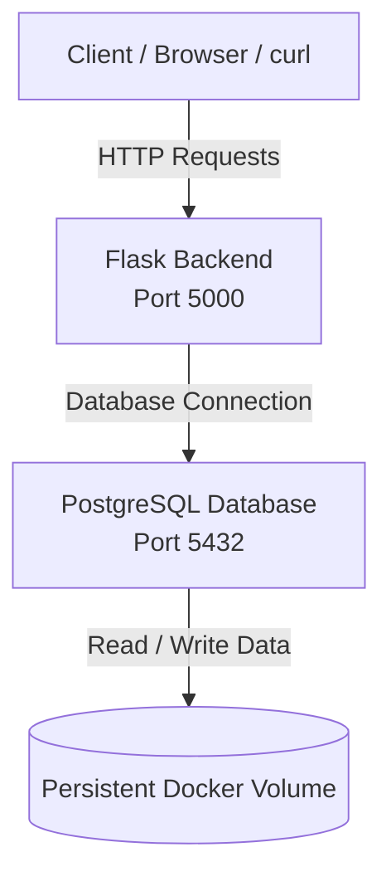

 <p align="center">
  
</p>

<h1 align="center">Multi-Service Application Using Docker Compose</h1>

<p align="center">
  <strong>A containerized Flask and PostgreSQL application orchestrated with Docker Compose.</strong>
</p>

<p align="center">
  
  
  
  
  
</p>

<p align="center">
  
  &nbsp;&nbsp;&nbsp;
  
  &nbsp;&nbsp;&nbsp;
  
  &nbsp;&nbsp;&nbsp;
  
</p>

---

## Overview

This project demonstrates how to build and run a multi-service application using **Docker Compose**.

The application consists of two independent services:

- **Backend:** A Python Flask application that exposes REST API endpoints.
- **Database:** A PostgreSQL database that stores application data.

Docker Compose orchestrates both services, configures their networking, manages environment variables, and ensures that the backend starts only after the database becomes healthy.

The application also demonstrates persistent database storage, service communication, container health checks, and API-to-database integration.

## Project Objectives

- Build a Flask backend using a custom Dockerfile.
- Run PostgreSQL as a separate container.
- Orchestrate multiple services using Docker Compose.
- Configure service-to-service communication.
- Manage database credentials through environment variables.
- Implement PostgreSQL health checks.
- Persist database data using Docker volumes.
- Verify database connectivity through API endpoints.
- Test data insertion and retrieval from the backend.

## Tech Stack

| Technology | Purpose |
|---|---|
| Docker | Containerization |
| Docker Compose | Multi-container orchestration |
| Python 3.12 | Backend programming language |
| Flask | REST API framework |
| PostgreSQL 16 | Relational database |
| psycopg2-binary | PostgreSQL adapter for Python |
| YAML | Docker Compose configuration |
| Linux | Development environment |
| Git & GitHub | Version control and source code hosting |

---

## Screenshots & Implementation Evidence

The following screenshots document the project structure, configuration, Docker build, running containers, database operations, and backend integration.

### 01. Project Structure

<p align="center">
  
</p>

Shows the organized project directories, backend files, Docker Compose configuration, and screenshot evidence.

### 02. Docker Compose Configuration

<p align="center">
  
</p>

Shows the configuration of the backend and PostgreSQL services, including ports, environment variables, volumes, and health checks.

### 03. Docker Build & Application Startup

<p align="center">
  
</p>

Evidence of successfully building the backend image and starting the multi-service application.

### 04. Running Containers

<p align="center">
  
</p>

Shows the running Flask backend and healthy PostgreSQL container using `docker compose ps`.

### 05. PostgreSQL Database Operations

<p align="center">
  
</p>

Demonstrates successful database connection, table creation, sample data insertion, and data retrieval using:

```sql
SELECT * FROM interns;
```

### 06. Backend & Database Integration

<p align="center">
  
</p>

Shows successful API responses from all three endpoints, including PostgreSQL connectivity and retrieval of intern records through the Flask backend.

---

## Architecture

The application follows a simple two-service architecture.



### Service Communication

- The Flask backend runs on port `5000`.
- PostgreSQL
