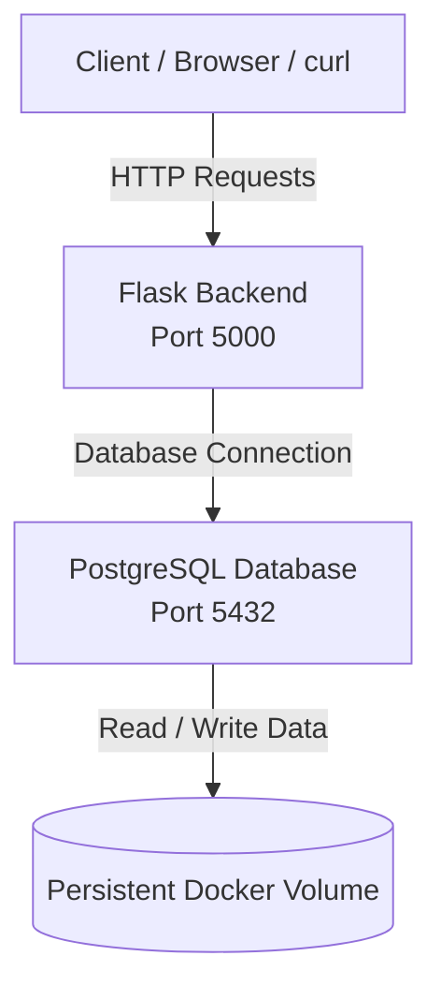
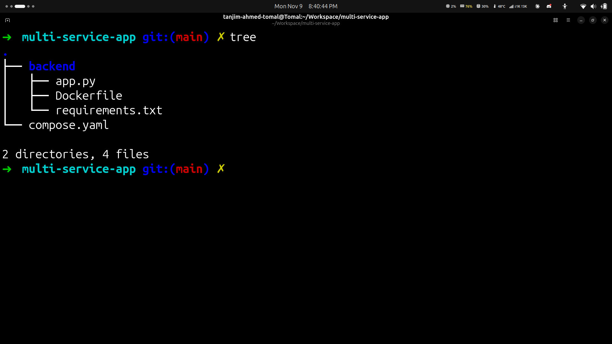
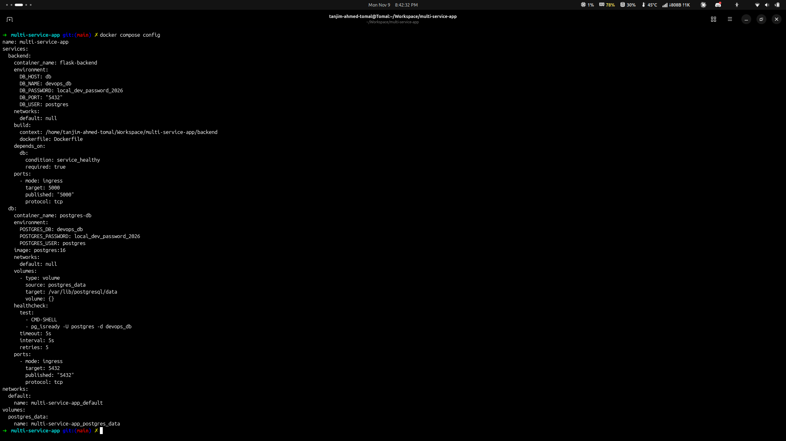
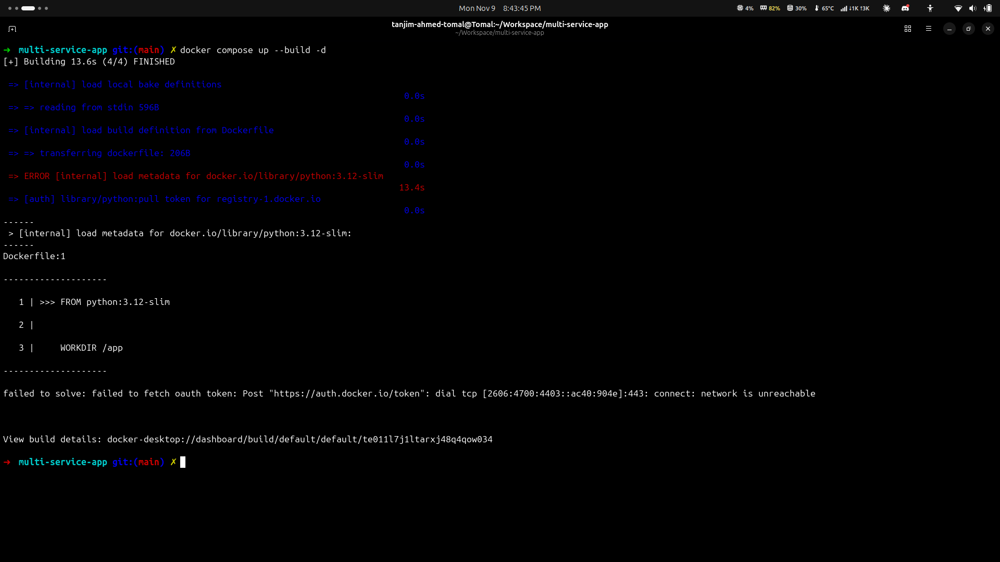
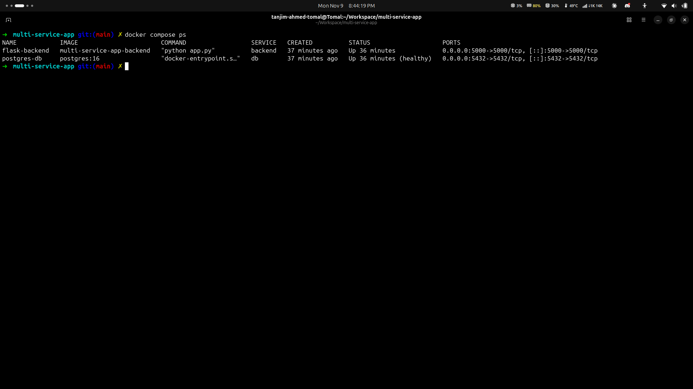
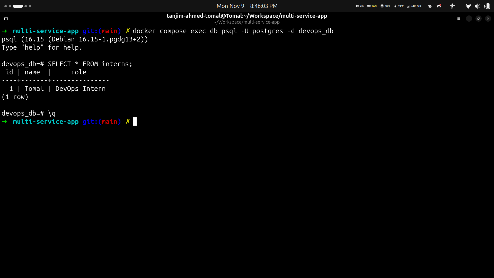
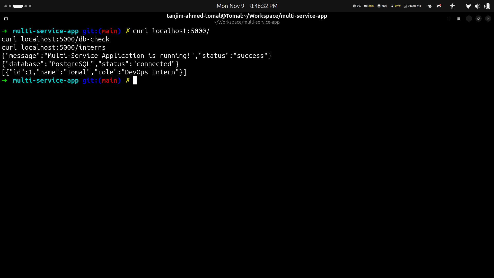

 <p align="center">
  
</p>

<h1 align="center">Multi-Service Application Using Docker Compose</h1>

<p align="center">
  <strong>A containerized Flask and PostgreSQL application orchestrated with Docker Compose.</strong>
</p>

<p align="center">
  
  
  
  
  
</p>

<p align="center">
  
  &nbsp;&nbsp;&nbsp;
  
  &nbsp;&nbsp;&nbsp;
  
  &nbsp;&nbsp;&nbsp;
  
</p>

---

## Overview

This project demonstrates how to build and run a multi-service application using **Docker Compose**.

The application consists of two independent services:

- **Backend:** A Python Flask application that exposes REST API endpoints.
- **Database:** A PostgreSQL database that stores application data.

Docker Compose orchestrates both services, configures their networking, manages environment variables, and ensures that the backend starts only after the database becomes healthy.

The application also demonstrates persistent database storage, service communication, container health checks, and API-to-database integration.

## Project Objectives

- Build a Flask backend using a custom Dockerfile.
- Run PostgreSQL as a separate container.
- Orchestrate multiple services using Docker Compose.
- Configure service-to-service communication.
- Manage database credentials through environment variables.
- Implement PostgreSQL health checks.
- Persist database data using Docker volumes.
- Verify database connectivity through API endpoints.
- Test data insertion and retrieval from the backend.

## Tech Stack

| Technology | Purpose |
|---|---|
| Docker | Containerization |
| Docker Compose | Multi-container orchestration |
| Python 3.12 | Backend programming language |
| Flask | REST API framework |
| PostgreSQL 16 | Relational database |
| psycopg2-binary | PostgreSQL adapter for Python |
| YAML | Docker Compose configuration |
| Linux | Development environment |
| Git & GitHub | Version control and source code hosting |

## Architecture

The application follows a simple two-service architecture.



### Service Communication

- The Flask backend runs on port `5000`.
- PostgreSQL runs on port `5432`.
- Both containers communicate through Docker Compose's default network.
- The backend connects to PostgreSQL using the service hostname `db`.
- A health check verifies that PostgreSQL is ready before the backend starts.
- A named Docker volume preserves database data beyond the container lifecycle.

## Project Structure

```text
multi-service-app/
│
├── backend/
│   ├── app.py
│   ├── Dockerfile
│   └── requirements.txt
│
├── screenshots/
│   ├── 01-project-structure.png
│   ├── 02-compose-configuration.png
│   ├── 03-docker-build.png
│   ├── 04-running-containers.png
│   ├── 05-postgresql-database.png
│   └── 06-backend-db-integration.png
│
├── .env
├── .env.example
├── .gitignore
├── compose.yaml
└── README.md
```

> The `.env` file contains local database credentials and is excluded from Git using `.gitignore`. The `.env.example` file provides a safe configuration template.

## Implementation Details

### 1. Flask Backend

The backend is developed using Flask and provides three endpoints:

| Endpoint | Method | Description |
|---|---|---|
| `/` | GET | Returns application status |
| `/db-check` | GET | Checks PostgreSQL connectivity |
| `/interns` | GET | Retrieves intern records from PostgreSQL |

The Flask application listens on `0.0.0.0:5000`, allowing it to accept connections from outside its container through the published Docker port.

### 2. Custom Dockerfile

The backend uses a custom Docker image based on `python:3.12-slim`.

Main steps:

1. Set `/app` as the working directory.
2. Copy and install Python dependencies.
3. Copy the Flask application.
4. Expose port `5000`.
5. Start the Flask application.

### 3. PostgreSQL Database

PostgreSQL 16 runs in its own container.

Database configuration:

| Configuration | Value |
|---|---|
| Database | `devops_db` |
| User | `postgres` |
| Database service | `db` |
| Port | `5432` |
| Table | `interns` |

The `interns` table contains:

| Column | Data Type | Description |
|---|---|---|
| id | SERIAL PRIMARY KEY | Unique record ID |
| name | VARCHAR(100) | Intern name |
| role | VARCHAR(100) | Intern role |

Sample data:

```sql
INSERT INTO interns (name, role)
VALUES ('Tomal', 'DevOps Intern');
```

### 4. Docker Compose Configuration

The `compose.yaml` file defines both services.

**Backend service**
- Builds from `./backend`.
- Publishes port `5000`.
- Loads environment variables from `.env`.
- Waits for the database health check to pass.

**Database service**
- Uses the official `postgres:16` image.
- Configures the database using environment variables.
- Publishes port `5432`.
- Uses a named volume for persistent storage.
- Implements a PostgreSQL readiness health check using `pg_isready`.

**Persistent storage**

```yaml
volumes:
  postgres_data:
```

This named volume ensures that PostgreSQL data is retained when the database container is recreated, provided the volume is not explicitly removed.

## Screenshots & Implementation Evidence

The following screenshots document the project structure, configuration, Docker build, running containers, database operations, and backend integration.

### 01. Project Structure

<p align="center">
  
</p>

Shows the organized project directories, backend files, Docker Compose configuration, and screenshot evidence.

### 02. Docker Compose Configuration

<p align="center">
  
</p>

Shows the configuration of the backend and PostgreSQL services, including ports, environment variables, volumes, and health checks.

### 03. Docker Build & Application Startup

<p align="center">
  
</p>

Evidence of successfully building the backend image and starting the multi-service application.

### 04. Running Containers

<p align="center">
  
</p>

Shows the running Flask backend and healthy PostgreSQL container using `docker compose ps`.

### 05. PostgreSQL Database Operations

<p align="center">
  
</p>

Demonstrates successful database connection, table creation, sample data insertion, and data retrieval using:

```sql
SELECT * FROM interns;
```

### 06. Backend & Database Integration

<p align="center">
  
</p>

Shows successful API responses from all three endpoints, including PostgreSQL connectivity and retrieval of intern records through the Flask backend.

## Problems Encountered & Solutions

During implementation, several practical issues were addressed.

| Problem | Solution |
|---|---|
| Backend and database needed separate environments | Created independent Docker Compose services. |
| Backend could not use `localhost` to reach PostgreSQL | Used the Compose service hostname `db` for internal networking. |
| Backend could start before PostgreSQL was ready | Added a PostgreSQL health check and `depends_on` with `service_healthy`. |
| Database credentials needed centralized management | Used `.env` and Docker Compose environment variable interpolation. |
| Credentials should not be committed to GitHub | Added `.env` to `.gitignore` and provided `.env.example`. |
| Database records needed to survive container recreation | Configured the named volume `postgres_data`. |
| Backend needed to accept external requests | Configured Flask to listen on `0.0.0.0` and published port `5000`. |
| Backend needed to retrieve actual database records | Implemented the `/interns` endpoint using `psycopg2`. |

## Running the Project Locally

### Prerequisites

- Docker Engine
- Docker Compose
- Git

### 1. Clone the Repository

```bash
git clone git@github.com:tanahmeeedsx/multi-service-app.git
cd multi-service-app
```

### 2. Configure Environment Variables

```bash
cp .env.example .env
```

Update the `.env` file with your local database credentials.

### 3. Build and Start Services

```bash
docker compose up --build -d
```

### 4. Verify Running Containers

```bash
docker compose ps
```

### 5. Test the API

```bash
curl http://localhost:5000/
curl http://localhost:5000/db-check
curl http://localhost:5000/interns
```

### 6. Access PostgreSQL

```bash
docker compose exec db psql -U postgres -d devops_db
```

Run:

```sql
SELECT * FROM interns;
```

### 7. Stop the Application

```bash
docker compose down
```

To stop the application and remove its persistent database volume:

```bash
docker compose down -v
```

> Warning: `docker compose down -v` permanently removes the Compose-managed database volume and its stored data.

## Verification Results

The following operations were successfully tested during implementation:

- [x] Custom Flask backend image built successfully.
- [x] PostgreSQL container started successfully.
- [x] PostgreSQL health check passed.
- [x] Backend and database services started through Docker Compose.
- [x] Flask application returned a successful response.
- [x] PostgreSQL connection verified through `/db-check`.
- [x] `interns` table created successfully.
- [x] Sample intern record inserted successfully.
- [x] Database records retrieved through SQL.
- [x] Database records retrieved through the Flask `/interns` endpoint.
- [x] Environment variables separated from application code.
- [x] Database persistence configured with a named Docker volume.

## Key Learnings

Through this project, I gained practical experience with:

- Docker image creation and container lifecycle management.
- Multi-service application orchestration using Docker Compose.
- Docker networking and service discovery.
- Flask application containerization.
- PostgreSQL integration with Python.
- Environment-based configuration and credential handling.
- Container health checks and service startup dependencies.
- Persistent storage using Docker volumes.
- API testing and database connectivity troubleshooting.

## Conclusion

This project demonstrates a practical approach to running a multi-service application using Docker Compose.

By separating the Flask backend and PostgreSQL database into independent containers, the application becomes easier to manage, configure, test, and maintain.

The implementation strengthened my understanding of containerization, service networking, database integration, persistent storage, and multi-container orchestration — essential concepts in modern DevOps engineering.

---

<p align="center">
  <strong>Built as part of my DevOps internship learning journey.</strong>
  <br />
  <a href="https://github.com/tanahmeeedsx">GitHub Profile</a>
  &nbsp; | &nbsp;
  <a href="https://github.com/tanahmeeedsx/multi-service-app">Project Repository</a>
</p>
